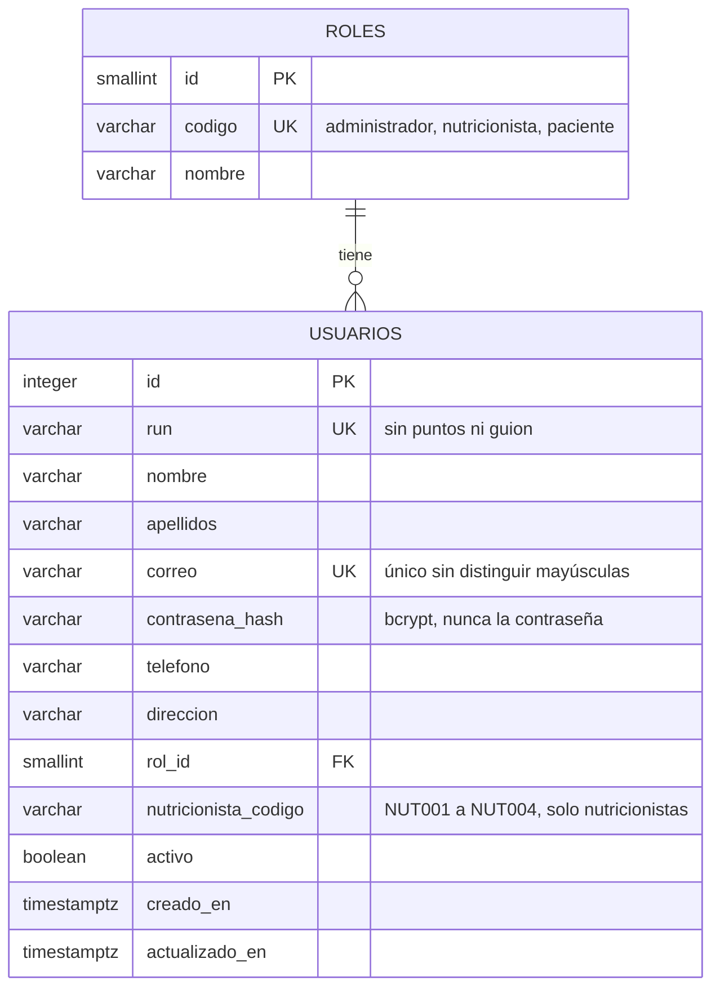
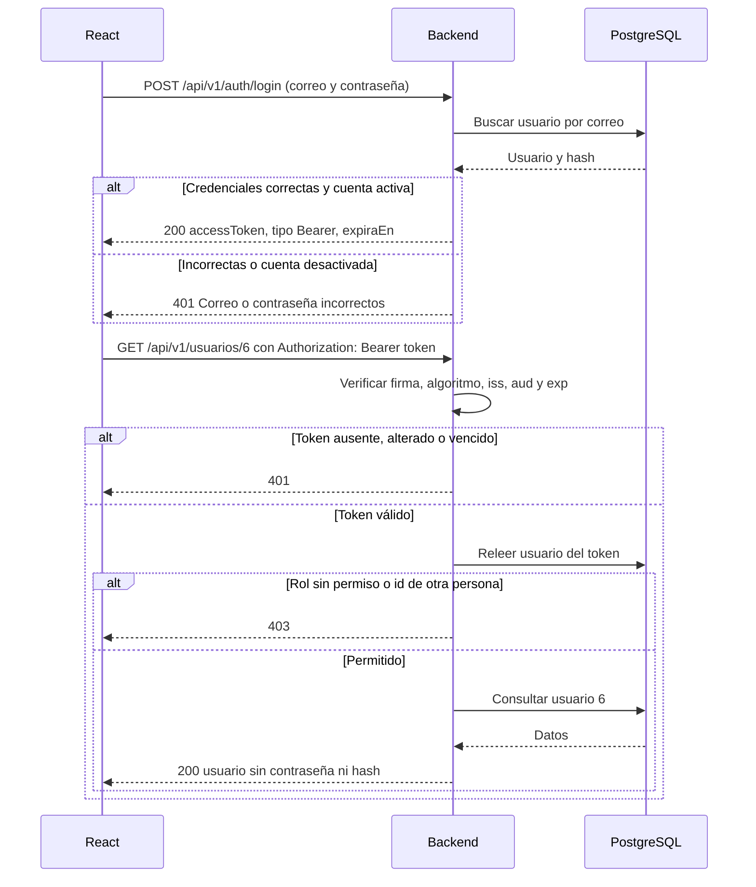

# NutriVida · Backend

API REST de la **Clínica Nutricional NutriVida** (caso Forma D, Temuco), construida con Node.js, Express, PostgreSQL y JWT.

- **Asignatura:** DSY1104 Desarrollo Fullstack II · Duoc UC · 2026
- **Equipo 6:** Jairo Cid (jair.cid@duocuc.cl), Anita Olivares (anit.olivares@duocuc.cl), Isidora Quinteros (isi.quinteros@duocuc.cl)
- **Frontend (React):** https://github.com/IsidoraQuinterosA/NutriVida

## Estado del trabajo

Avance al 18 de noviembre de 2026. **Listo** significa probado en Swagger o Postman con el resultado guardado en la base de datos. **En avance** significa que hay código y commits, aunque falte terminarlo o probarlo.

| Operación | Ruta | Estado | Cómo se comprobó |
|---|---|---|---|
| Tabla de usuarios | `db/esquema.sql` | Listo | Tablas `roles` y `usuarios` en PostgreSQL. Los datos siguen después de reiniciar la API. Contraseñas con hash bcrypt |
| Registro de paciente | `POST /api/v1/auth/register` | Listo | 201 con el usuario creado y rol `paciente`; 400 con datos inválidos; 409 con RUN o correo repetido |
| Inicio de sesión | `POST /api/v1/auth/login` | Listo | 200 con JWT y vigencia; 401 genérico con credenciales incorrectas o cuenta desactivada |
| Usuario autenticado | `GET /api/v1/auth/me` | Listo | 200 con token válido; 401 sin token o con token alterado |
| Listar usuarios | `GET /api/v1/usuarios` | Listo | 200 para administrador, con filtro `?rol=`; 403 para otros roles |
| Ver un usuario | `GET /api/v1/usuarios/{id}` | Listo | 200 para el administrador o la misma persona; 403 si el id es de otra persona; 404 si no existe |
| Crear usuario con rol | `POST /api/v1/usuarios` | Listo | 201 para administrador, con rol y perfil de nutricionista |
| Modificar usuario | `PUT /api/v1/usuarios/{id}` | Listo | 200 con datos válidos; 403 si un no administrador intenta cambiar rol o estado; 409 si el administrador intenta cambiar su propio rol |
| Desactivar usuario | `DELETE /api/v1/usuarios/{id}` | Listo | 204 y la cuenta ya no inicia sesión; 409 si el administrador intenta desactivarse a sí mismo |
| Documentación Swagger | `/api/docs` | Pendiente | Domingo 22, con todos los endpoints anteriores |
| Catálogo de servicios | `/api/v1/servicios` | Pendiente | Semana 16 |
| Citas (flujo principal) | `/api/v1/citas` | Pendiente | Semana 16, con la regla de horario ocupado (409) |
| Integración con el frontend | Axios en React | Pendiente | Semana 16 |
| Despliegue con Amazon RDS | Guía 18 | Pendiente | Mismo código; solo cambian las variables de conexión |

## Alcance

El backend cubre lo que hoy el frontend guarda en el navegador:

- **Usuarios, autenticación y roles:** registro de pacientes, inicio de sesión con JWT, roles Administrador, Nutricionista y Paciente, y gestión de usuarios por el administrador.
- **Catálogo:** servicios y planes nutricionales, con su CRUD para el administrador.
- **Citas:** solicitar, listar, ver y cambiar el estado de una cita. Regla del negocio: un nutricionista no puede tener dos citas en el mismo horario (409). Cada nutricionista ve solo sus citas y el paciente ve solo las suyas.

Reportes, categorías, servicios críticos, historial, perfil y comprobante quedan para el examen final, como indica la pauta.

## Decisiones técnicas

| Decisión | Elección | Por qué |
|---|---|---|
| Lenguaje y framework | Node.js 24 con Express 5 | El equipo ya trabaja en JavaScript en el frontend. Express 5 envía solo los errores de funciones `async` al manejador de errores |
| Ejecución | Proceso Node.js en EC2 (puerto 3000) | Un servidor que queda escuchando y atiende todas las rutas. Lambda queda como alternativa estudiada en la guía 18 |
| Base de datos | PostgreSQL | Relacional, con claves foráneas, índices únicos y restricciones. Es el motor de Amazon RDS que usa la guía 18 |
| Acceso a datos | Paquete `pg` con consultas parametrizadas | Los valores viajan separados del SQL (`$1`, `$2`), lo que evita la inyección SQL |
| Contraseñas | bcrypt (`bcryptjs`), costo 12 | Ver la sección Seguridad |
| Autenticación | JWT firmado con HS256 (`jsonwebtoken`) | Ver la sección Seguridad |
| Documentación | OpenAPI 3 con Swagger UI (`swagger-ui-express`), en preparación | La documentación se probará desde el navegador y vivirá junto al código |
| Límite de intentos | `express-rate-limit` en el login | 10 intentos cada 15 minutos por IP, para frenar ataques de fuerza bruta |
| CORS | `cors` con `CORS_ORIGINS` | Solo el origen del frontend puede leer las respuestas. CORS no reemplaza la autorización |

## Diseño de datos



- Cada usuario tiene **un rol** y cada rol puede tener **muchos usuarios** (1 a N).
- El **RUN** y el **correo** no se repiten. El correo es único sin importar mayúsculas (`LOWER(correo)`).
- El rol inicial lo asigna el servidor. Solo el administrador puede cambiarlo.
- Los usuarios **no se borran: se desactivan** (`activo = false`). Así se conserva su historial de citas y la cuenta deja de poder iniciar sesión.
- Los datos simulados del frontend (`src/data/usuarios.js`) pasan a ser los **datos iniciales** de `db/usuarios-iniciales.js`, con las mismas cuentas de prueba y su contraseña guardada con hash.
- Próximas tablas: `nutricionistas`, `categorias`, `servicios`, `citas` y `cita_servicios`.

## Organización y responsabilidades

Misma división que la guía 19, con la estructura del proyecto de ejemplo de la guía 20:

| Responsabilidad | Carpeta | Qué hace |
|---|---|---|
| Rutas HTTP | `src/routes/` | Reciben la solicitud, llaman al DTO y al servicio, y responden con el estado HTTP |
| Datos de entrada y salida | `src/dto/` | Validan el cuerpo y dejan pasar solo los campos permitidos. El DTO de salida nunca incluye el hash |
| Servicios | `src/services/` | Reglas del negocio y de permisos: quién puede ver o modificar qué |
| Acceso a datos | `src/repositories/` | Consultas SQL parametrizadas a PostgreSQL |
| Seguridad | `src/security/`, `src/middlewares/` | Hash de contraseñas, emisión y verificación del JWT, y control de roles |
| Conexión | `src/db/pool.js` | Grupo de conexiones a PostgreSQL configurado por variables de entorno |
| Base de datos | `db/`, `scripts/` | Esquema SQL, datos iniciales y script para crearlos |

**Reparto del equipo:**

| Integrante | Parte | Estado |
|---|---|---|
| Jairo Cid | Base del proyecto, conexión a PostgreSQL, usuarios y autenticación con JWT | Listo |
| Anita Olivares | Por definir: catálogo, citas o integración con el frontend | Pendiente |
| Isidora Quinteros | README del backend: decisiones, diseño de datos, seguridad y estado del trabajo | Listo |
| Isidora Quinteros | Por definir: catálogo, citas o integración con el frontend | Pendiente |

## API y documentación viva

La documentación con Swagger UI se agregará en `/api/docs` para el domingo 22. Mientras tanto, los endpoints se prueban con Postman o `curl` en `http://localhost:3000`. Desde otro equipo se usa la IP pública de la EC2 en lugar de `localhost`, con el puerto 3000 abierto en el grupo de seguridad.

Todas las respuestas de error tienen la misma forma: `{ "mensaje": "...", "detalles": [] }`.

| Estado | Cuándo |
|---|---|
| 200 / 201 / 204 | Consulta o modificación correcta / usuario creado / usuario desactivado |
| 400 | JSON mal formado o datos que no cumplen las validaciones |
| 401 | Credenciales incorrectas, o token ausente, alterado o vencido |
| 403 | Rol sin permiso, o intento de ver o modificar los datos de otra persona |
| 404 | El usuario no existe |
| 409 | RUN o correo repetido, o cambio no permitido sobre la propia cuenta |
| 429 | Demasiados intentos de inicio de sesión |

Relación con el frontend:

| Pantalla del frontend | Endpoint |
|---|---|
| Registro | `POST /api/v1/auth/register` |
| Iniciar sesión | `POST /api/v1/auth/login` y luego `GET /api/v1/auth/me` |
| Admin · Usuarios (lista, nuevo, editar, activar) | `GET`, `POST`, `PUT` y `DELETE` en `/api/v1/usuarios` |
| Panel del paciente · datos personales | `GET` y `PUT` en `/api/v1/usuarios/{id}` con su propio id |

## Seguridad

**Contraseñas.** Se guardan con **bcrypt** y costo 12, nunca en texto plano. bcrypt es un algoritmo lento a propósito y agrega una sal aleatoria a cada contraseña: dos usuarios con la misma contraseña tienen hashes distintos, y probar millones de contraseñas es costoso. Se usa `bcryptjs`, que funciona sin compilar código nativo. La contraseña se limita a 72 caracteres porque bcrypt no considera los siguientes.

**JWT.** El login entrega un token firmado con **HS256** y una clave secreta que vive en la variable `JWT_SECRET`, fuera del repositorio y fuera de React. El token contiene:

| Campo | Valor |
|---|---|
| `sub` | Id del usuario |
| `rol` | Rol al momento del login, para que el frontend muestre sus pantallas |
| `iss` | `nutrivida-api` |
| `aud` | `nutrivida-web` |
| `exp` | Vencimiento, **1 hora** después del login |

No lleva contraseñas ni datos sensibles. La vigencia de 1 hora cubre una sesión de uso normal y limita el daño si un token se filtra. Por ahora no hay token de renovación: al vencer, se vuelve a iniciar sesión.

**Verificación.** En cada ruta protegida, el middleware `autenticar` comprueba la **firma**, el **algoritmo** permitido, el **emisor**, el **destinatario** y la **vigencia**. Decodificar el token no basta. Además vuelve a leer al usuario en la base de datos: si la cuenta fue desactivada, el token deja de servir aunque no haya vencido, y el rol que se usa es el actual.

**Permisos.** Se comprueban en el servidor, no solo en React:

- `requerirRol('administrador')` protege listar, crear y desactivar usuarios.
- Ver y modificar un usuario solo lo puede hacer el administrador o la misma persona. Cambiar el id en la URL responde 403.
- Solo el administrador puede cambiar el rol, el perfil de nutricionista o el estado de una cuenta.

**Otros controles.** El login responde el mismo mensaje si el correo no existe o si la contraseña es incorrecta, y compara un hash de relleno para no revelar por el tiempo de respuesta si la cuenta existe. Hay un límite de intentos de login, un tamaño máximo del cuerpo (16 kB), y las contraseñas y tokens no se escriben en los registros. En producción las credenciales deben viajar por HTTPS.

**Sesión en el frontend (propuesta).** Guardar el token en `sessionStorage`: sobrevive a la recarga de la página, que es lo que pide la rúbrica, y se borra al cerrar la pestaña. Su riesgo es que un script inyectado (XSS) podría leerlo, por eso React no debe insertar HTML sin escapar. Al cerrar sesión o recibir un 401, el frontend borra el token. Borrarlo no invalida una copia ya emitida, que sigue valiendo hasta su `exp`; desactivar la cuenta sí la invalida, porque el backend vuelve a leer al usuario.



Fuentes:

- OWASP. *Password Storage Cheat Sheet*. https://cheatsheetseries.owasp.org/cheatsheets/Password_Storage_Cheat_Sheet.html
- OWASP. *REST Security Cheat Sheet*. https://cheatsheetseries.owasp.org/cheatsheets/REST_Security_Cheat_Sheet.html
- OWASP. *JSON Web Token Cheat Sheet*. https://cheatsheetseries.owasp.org/cheatsheets/JSON_Web_Token_for_Java_Cheat_Sheet.html
- IETF. *RFC 7519: JSON Web Token*. https://www.rfc-editor.org/rfc/rfc7519
- Documentación de `jsonwebtoken`: https://github.com/auth0/node-jsonwebtoken

## Cómo ejecutar

Requisitos: Node.js 24, PostgreSQL 16 o superior y Git.

1. Instalar PostgreSQL en la EC2 (Ubuntu):
   ```bash
   sudo apt update
   sudo apt install -y postgresql
   ```
2. Crear el usuario y la base de datos. Reemplaza `UNA_CONTRASEÑA` por una propia:
   ```bash
   sudo -u postgres psql -c "CREATE ROLE nutrivida_app LOGIN PASSWORD 'UNA_CONTRASEÑA';"
   sudo -u postgres psql -c "CREATE DATABASE nutrivida OWNER nutrivida_app;"
   ```
3. Clonar e instalar:
   ```bash
   git clone https://github.com/JairoCidM/NutriVida-backend.git
   cd NutriVida-backend
   npm ci
   cp .env.example .env
   ```
4. Completar `.env`: `PGPASSWORD` con la contraseña del paso 2, y `JWT_SECRET` con una clave aleatoria, que se puede generar con `openssl rand -hex 32`. El archivo `.env` no se sube al repositorio.
5. Crear las tablas y los datos iniciales. Se puede repetir sin duplicar usuarios:
   ```bash
   npm run db:init
   ```
6. Iniciar la API:
   ```bash
   npm start
   ```
   La terminal muestra `API de NutriVida escuchando en el puerto 3000`. Para comprobarlo, se abre `http://localhost:3000/api/v1/health`, que responde `{"estado":"ok","baseDeDatos":"conectada"}`.

Cuentas de prueba (datos ficticios, las mismas del frontend):

| Rol | Correo | Contraseña |
|---|---|---|
| Administrador | admin@nutrivida.cl | admin1234 |
| Nutricionista | carolina.fuentes@nutrivida.cl | nutri1234 |
| Paciente | ana.perez@correo.cl | paciente123 |

## Pruebas realizadas

Pruebas manuales con `curl` contra la API y PostgreSQL en la EC2, el 18 de noviembre de 2026:

| Caso | Resultado esperado | Resultado obtenido |
|---|---|---|
| Registro válido que además envía `rol: administrador` | 201 y rol `paciente` | 201, rol `paciente` |
| Registro con el mismo RUN o correo | 409 | 409 |
| Registro con RUN con puntos, correo y contraseña inválidos | 400 con cada error | 400 con 6 errores |
| Cuerpo JSON mal formado | 400 | 400 |
| Login con correo en mayúsculas y contraseña correcta | 200 con token | 200, token con `sub`, `rol`, `iss`, `aud` y `exp` |
| Login con contraseña incorrecta o correo inexistente | 401 con el mismo mensaje | 401 en ambos |
| `GET /auth/me` sin token / con token alterado | 401 | 401 / 401 |
| Paciente lista usuarios | 403 | 403 |
| Paciente ve su propio id / el id de otra persona | 200 / 403 | 200 / 403 |
| Paciente intenta cambiarse el rol | 403 | 403 |
| Administrador crea un nutricionista con perfil NUT004 | 201 | 201 |
| Administrador desactiva al usuario y este intenta entrar | 204 y luego 401 | 204 y 401 |
| Administrador intenta desactivarse a sí mismo | 409 | 409 |
| Usuario inexistente / id no numérico | 404 / 400 | 404 / 400 |
| Reiniciar la API y volver a listar | Los usuarios siguen | Siguen los 8 usuarios iniciales |

Pendiente: pruebas automatizadas con `node:test` y `supertest`, como el proyecto de ejemplo de la guía 20, y las pruebas desde Postman con la IP pública de la EC2.

